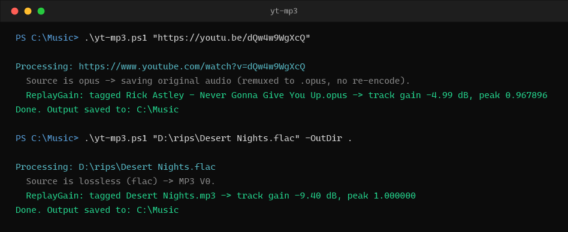

# yt-mp3

A source-aware PowerShell audio downloader and extractor wrapping [`yt-dlp`](https://github.com/yt-dlp/yt-dlp), [`ffmpeg`](https://ffmpeg.org/), and [`rsgain`](https://github.com/complexlogic/rsgain).



It extracts high-fidelity audio with embedded cover art, clean metadata, and **ReplayGain 2.0** loudness normalization.

## Core Design & Audio Philosophy

The script is **source-aware**:

- **Lossy YouTube Audio (Opus / AAC)**: Saved **directly as-is without transcoding** (zero generation loss). YouTube's high-bitrate Opus stream (~128–160 kbps, 48 kHz) is losslessly remuxed from `.webm` into a standard `.opus` container (`Ogg Opus`) so audio players, Discord bots (e.g. Ukulele / Lavaplayer), and ReplayGain scanners can read and tag it. Pass **`-Mp3`** if you also need an MP3 copy alongside the original Opus.
- **Lossless Sources (FLAC, ALAC, WAV, …)**: Compressed down to a high-quality **MP3 V0** (≈245 kbps) by default. Pass **`-Flac`** to preserve the original lossless file instead (or add `-Mp3` to keep the lossless original **and** generate an MP3).
- **Universal Embedded Cover Art**: Standardized JPEG cover art (`METADATA_BLOCK_PICTURE` for Opus/FLAC, ID3v2 APIC for MP3, `covr` for M4A) is embedded automatically across all formats.

### ReplayGain 2.0

Every file the script **produces** is scanned and tagged with **ReplayGain 2.0** loudness metadata with true-peak clipping protection (via [`rsgain`](https://github.com/complexlogic/rsgain), auto-downloaded on first use).
- **Track Mode** (`-s i`): Tagged by default for single-track downloads.
- **Album Mode** (`-AlbumGain` / `-Playlist` / `-SplitChapters`): Automatically computes both **Track Gain** and **Album Gain** (`R128_TRACK_GAIN` and `R128_ALBUM_GAIN`), preserving relative intra-album dynamic range.
- Pass `-NoReplayGain` to skip scanning. Local source files are never modified.

## Usage

### Direct Lossless Opus Extraction (YouTube)
```powershell
.\yt-mp3.ps1 "https://www.youtube.com/watch?v=dQw4w9WgXcQ"
```

### Pipeline Support (Clipboard & URL Lists)
```powershell
# Pipe URL from clipboard
Get-Clipboard | .\yt-mp3.ps1 -CleanAudio -CleanMetadata

# Pipe batch list of URLs or local audio paths from a text file
Get-Content urls.txt | .\yt-mp3.ps1 -OutDir D:\Music -AlbumGain
```

### Clean Music Videos (Strip Dialogue Skits & Title Junk)
```powershell
.\yt-mp3.ps1 "https://www.youtube.com/watch?v=dQw4w9WgXcQ" -CleanAudio -CleanMetadata
```

### Age-Gated / Member Content (Browser Cookies)
```powershell
.\yt-mp3.ps1 "https://www.youtube.com/watch?v=VIDEO_ID" -CookiesBrowser chrome
```

### Full Album Chapter Splitting
Split a full-album YouTube upload into discrete, numbered, and tagged `.opus` tracks with Album Gain:
```powershell
.\yt-mp3.ps1 "https://youtu.be/album_video" -SplitChapters -OutDir D:\Music\Album
```

### Download Playlists with Album Gain
```powershell
.\yt-mp3.ps1 "https://www.youtube.com/playlist?list=PL123..." -Playlist -AlbumGain -OutDir D:\Music
```

### Convert Local Lossless Audio to MP3 with ReplayGain
```powershell
.\yt-mp3.ps1 "E:\Music\track.flac" "E:\Music\track.wav" -OutDir D:\Music\MP3
```

---

## Options

| Parameter | Description |
| --------- | ----------- |
| `Url` | One or more YouTube URLs or local audio file paths (positional & pipeline). Aliases: `-Path`, `-Uri`. |
| `-OutDir` | Folder to save output files into (defaults to current directory). |
| `-CleanAudio` / `-NoSponsor` | Automatically removes non-music video skits, intro dialogue, and outro cards via SponsorBlock (`music_offtopic,sponsor`). |
| `-CleanMetadata` | Cleans YouTube title junk (e.g. `(Official Video)`, `[4K Remaster]`, `[HD]`, `(Lyric Video)`, `Visualizer`) and normalizes tags. |
| `-SplitChapters` | Splits full-album or concert YouTube uploads into discrete, numbered tracks based on video chapters. |
| `-AlbumGain` | Computes ReplayGain 2.0 Album Gain alongside Track Gain. Automatically enabled for playlists and chapter splits. |
| `-NoReplayGain` | Skip ReplayGain loudness scanning. |
| `-NoThumbnail` | Skip downloading and embedding cover art. |
| `-Mp3` | Additionally create an MP3 for lossy sources (or alongside a kept `-Flac`). |
| `-Flac` | Keep a lossless source as-is instead of converting it to MP3. |
| `-Quality` | Override MP3 bitrate quality (`V0`, `V2`, `320k`, `256k`, `192k`, `128k`, or `match`). |
| `-CookiesBrowser` | Extract cookies from browser (`chrome`, `firefox`, `edge`, `brave`, `opera`, `vivaldi`, `safari`, `chromium`) for age-gated/member content. |
| `-Lyrics` | Download and embed synchronized/unsynchronized subtitles & lyrics. |
| `-Retries` | Number of network retries on connection dropouts (default: `10`). |
| `-Template` | Custom yt-dlp filename template (e.g. `%(artist)s - %(title)s.%(ext)s`). |
| `-NoOverwrites` | Prevent overwriting existing output files. |
| `-Playlist` | Download the full playlist instead of just the single video. |

---

## Dependencies

The script uses `yt-dlp`, `ffmpeg`, and `rsgain`.
On first run on Windows, it automatically installs `yt-dlp` and `ffmpeg` via `winget` if missing:

```powershell
winget install yt-dlp.yt-dlp
winget install Gyan.FFmpeg
```

[`rsgain`](https://github.com/complexlogic/rsgain) (ReplayGain 2.0 scanner) is auto-downloaded from GitHub releases into `%LOCALAPPDATA%\yt-mp3\tools\rsgain` with SHA-256 integrity verification.

## Notes

- Downloaded audio files are git-ignored so only the script and docs are tracked.
- If you hit a PowerShell execution-policy error on a new machine, run:
  `powershell -ExecutionPolicy Bypass -File .\yt-mp3.ps1 "<url>"`
